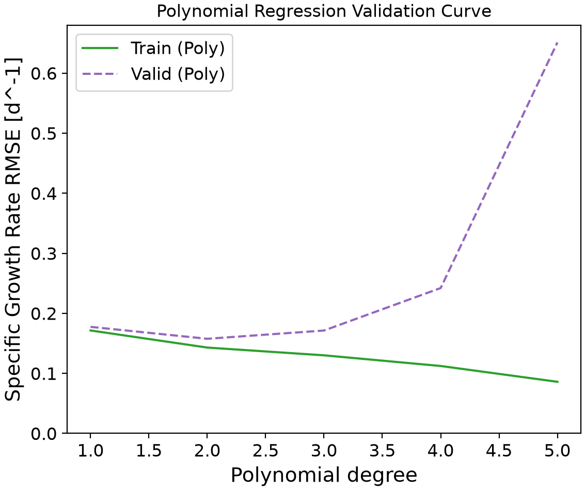
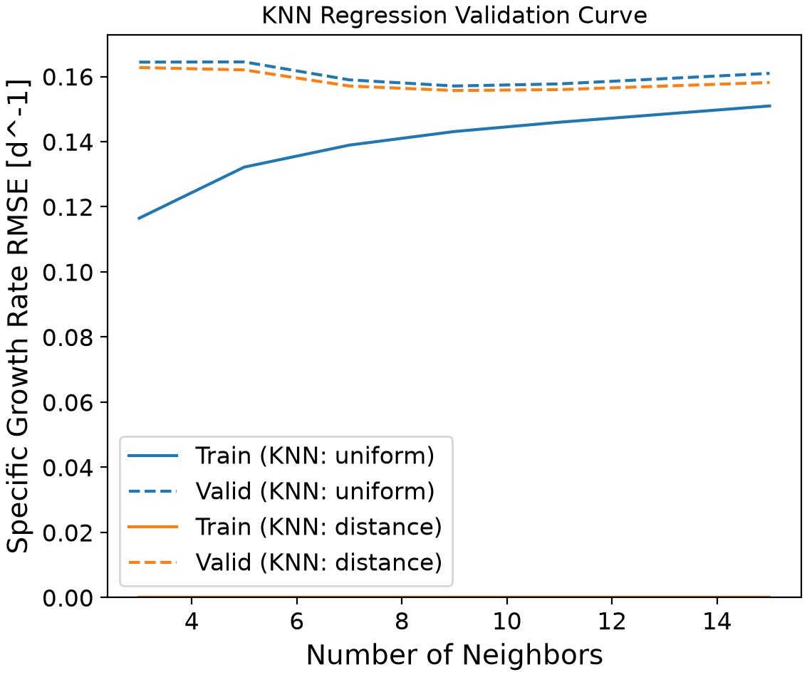

# Cell Growth Machine Learning Model

---
The objective of this project was to develop a **machine learning model** using Python 
which can **predict the specific growth rate of cells** based on **culture conditions**, 
specifically the temperature, pH, glucose concentration and lactate concentration.

Such a model is useful in research. It allows researchers to predict the best conditions to stimulate growth to increase yield, reduce cost by testing conditions through the model rather than through physical trials, and troubleshoot conditions in real-time. 
Overall the model provides researchers with a greater understanding the effects of cell culture conditions.

## Highlights

---
- Executes automated machine learning pipelines for cell growth predictions.
- Optimizes hyperparameters using k-fold cross-validation through GridSearchCV.
- Evaluates regression models using root mean squared error metrics.
- Generates validation curves to analyze the model and prevent overfitting.
- Exports predictions and actual values for comparison and reporting.

## Environment

---
- Python (v3.14.7)
- pandas (v3.0.6)
- matplotlib (v3.11.0)
- numpy (2.5.2)
- scikit-learn (1.9.0)

## Code Design

---
### Data Loading
The first stage of the workflow involves importing the cell culture dataset from a CSV file using the `data_loading` function. 
The data is structured into NumPy arrays for compatibility with the `Scikit-learn` library, and is also split into training and testing subsets using an 80/20 train-test split. 
This ensures that the model is trained on the cell culture data while an unseen subset remains for unbiased validation, helping to set the foundation for subsequent feature engineering and model training.

### Preprocessing and Feature Engineering
Data preprocessing transforms the loaded raw data into a structured format the program understands, making it a critical step in building machine learning models. 
Using `Scikit-learn`, the input variables-temperature, pH, glucose concentration and lactate concentration-are standardized so each feature has a mean of zero and a standard deviation of one. 

The pipeline creates and evaluates two different models types: the *k*-nearest neighbors (KNN) regression pathway and the polynomial regression pathway. 
In this way, later justification of the selected model can be properly supported. 

As for the polynomial regression pathway, polynomial and interaction features were generated. 
If it were a simple linear model, the program would assume all variables interact separately. 
However, in biological processes such as cell growth, variables interact. 
Therefore, it was necessary to generate all the possible polynomial combinations of the features from the variables. 

### Model Training and Hyperparameter Tuning
Now that the data has been preprocessed and the features engineered to suit the model requirements, the pipeline feeds the data into the regression algorithms for training. 
A `Scikit-learn` pipeline is used to bundle data preprocessing, feature engineering and model training into a unified workflow, improving reproducibility and reducing common machine learning workflow errors. 
Simple model training is essential in the model development process as it teaches the model to recognize patterns in data so that the trained model can analyze unseen data and make predictions. 
In order to maximize performance and prevent overfitting or underfitting of the model, hyperparameter tuning is necessary. 
To achieve this, Grid Search Cross-Validation (`GridSearchCV`) is employed to train the models.

This is a process which involves searching through a defined grid of configuration variables, trains and evaluates the model for every combination of the hyperparameters using cross-validation to find the optimal hyperparameters. 
For the polynomial regression pathway, the grid search identifies the optimal polynomial degree within a range of 1 to 5. 
For KNN regression pathway, it tests varying odd numbers of neighbors (*k*) alongside uniform and distance weight controls. 
This determines whether data points should be given equal weight or be weighted proportionally to the inverse of their spatial distance. 
Ultimately, the stage of the workflow returns the highest performing hyperparameter for each regression model.

### Model Evaluation and Validation
For the final stage of the executed program, the model is tested and validated. 
The unseen 20% of the data previously set aside as test data is used to calculate the Root Mean Squared Error (**RMSE**) and **R2** score for both the polynomial and KNN models. 
Testing using unseen data is the best method to determine if the model learned how to analyze the data in order to forecast the target outcomes. 
The predicted values are exported to CSV files with the actual values. 
As for validation, validation curves are generated and exported. 
These figures allow for the visualization of when overfitting and underfitting occurs during hyperparameter tuning.

This is the final output of the pipeline and the final stage of the workflow, providing the user the information and data plots needed to select the best model architecture for predicting cell growth rates.
## Analysis

---
### Model Selection and Justification
The objective of this machine learning pipeline was to predict the specific growth rate of cells based on four cell culture parameters: temperature, pH, glucose concentration and lactate concentration. \
To achieve this, two model architectures were evaluated: a Polynomial Regression model and a *k*-Nearest Neighbors (KNN) Regression model. 

Based on the hyperparameter tuning and cross-validation results, the **Polynomial Regression with a degree of 2** was selected as the optimal regression model. 

During the evaluation phase, the degree-2 Polynomial model achieved a **RMSE** of 0.1570 and an **R2** score of 0.3841. 
As demonstrated in `validation_curve_polynomial.png`, a polynomial degree of 2 provided the lowest validation error. 
Increasing the polynomial degree to degrees  of 3, 4, and 5 resulted in severe overfitting, as the validation curves show the training error dropping toward zero but the validation error exponentially spiking. 

On the other hand, the alternative KNN model was optimized at *k*=9 using distance-based weighting. 
While this model successfully memorized the training data (as seen by the zero-error training line in `validation_curve_knn.png`), it **yielded a higher validation RMSE (0.1587) and a lower R2 (0.3707)**. 
Therefore, the degree-2 Polynomial model was chosen because it was able to better capture the cell growth process without severe overfitting or higher error as observed in the distance-weighted KNN algorithm.

### Disadvantages of the Polynomial Model
All that being said, there are some disadvantages to the polynomial regression model. 
In general these models are sensitive to outliers and so predictions outside the range of the training data tends to behave wildly. 
Polynomial regression models also have a high risk of overfitting, especially at higher degrees as seen in the validation curve. 
However, hyperparameter tuning is performed to offset this issue by keeping the degree low. Another limitation of this model is the R2 score of 0.3841. 
An R2 score greater than zero indicates the model is better than predicting the mean, however the model is still only successfully explaining approximately 38%. 
Cell growth involves many factors, many of which were not included in this dataset and therefore likely account for the remaining variance. 
Overall, the model is capable of predicting baseline cell growth expectations but is limited in predicting exact cell growth rates.

### Influences on Specific Growth Rate
* **Temperature:** The temperature of a cell culture governs the kinetics of cellular enzymes and maintains the fluidity of the cell membrane. The optimal temperature would maximize enzymatic activity, encouraging cellular reproduction, while temperature too high or too low lead to denaturation of proteins and arrest of metabolism respectively.
* **pH:** The intracellular and extracellular pH of a cell culture should be strictly supervised as it impacts protein folding, nutrient transport across the cell membrane and cellular homeostasis. In fact, the cell itself expands significant energy to maintain the internal pH, so if the external pH were to deviate too much, it would create a significant energy burden to the cell, reducing the energy available to be directed to growth.
* **Glucose Concentration:** Glucose is the primary carbon and energy source of the cell and is essential for glycolysis and cellular respiration. A cell with a sufficient glucose supply can undergo rapid division whereas glucose depletion triggers cellular starvation pathways possibly leading to cell death.
* **Lactate Concentration:** Lactate is a toxic metabolic byproduct of glycolysis. Lactate is acidic, so as it accumulates in the culture, it lowers the pH creating a burden to the cell and inhibiting growth.

### Cell Culture Conditions
* **High Specific Growth Rate:** The cell culture will exhibit the maximum growth rate when all parameters are in their ideal ranges. This occurs when the temperature and pH are maintained within the cells optimal range, glucose is abundant and lactate is kept minimal.
* **Low Specific Growth Rate:** Alternatively, minimal growth occurs under stressful or toxic conditions when these values are not optimal. This occurs when glucose is depleted, lactate has accumulated to toxic levels or when temperature and pH have strayed significantly away from their optimal bounds. These conditions lead to starvation, enzymatic failure and even cell death.
* **Regions of Unreliable Prediction:** As discussed earlier, the degree-2 polynomial model's predictions become unreliable when evaluated on conditions that fall outside the range of the training data. For example, if the model were fed extremely high temperatures, such as 80°C, the output will likely result in a biologically impossible specific cell growth rate.

### Potential Applications
A cell growth rate prediction model has a wide-range of potential applications, across biotechnology, medicine and research.
Bioprocessing relies heavily on maintaining tight control of environmental variable. 
This model could be used to forecast growth trends in real time by continuously feeding the model culture data. 
In addition to real-time monitoring, the model can be used to develop control strategies. 
The model tracks variables such as glucose concentration and lactate concentration and can therefore be used to determine when the cell is at risk of starvation or high toxicity levels. 
With this knowledge, operators could automate adjusting physical controls to prevent reaching stressful or toxic conditions by, for example, adding glucose to the system when it reaches a certain concentration. 
This model can also be used for process development. 
Physical experiments can be expensive and time-consuming. 
If the bioprocess can be mimicked to a certain degree of accuracy, scientists can use the model test different cell culture parameters settings without needing to spend as much money or as much time physically performing each experiment with each parameter setting. 
Scientists can then identify the optimal operational parameters for their bioprocess before scaling up to physical experiments in bioreactors. 

